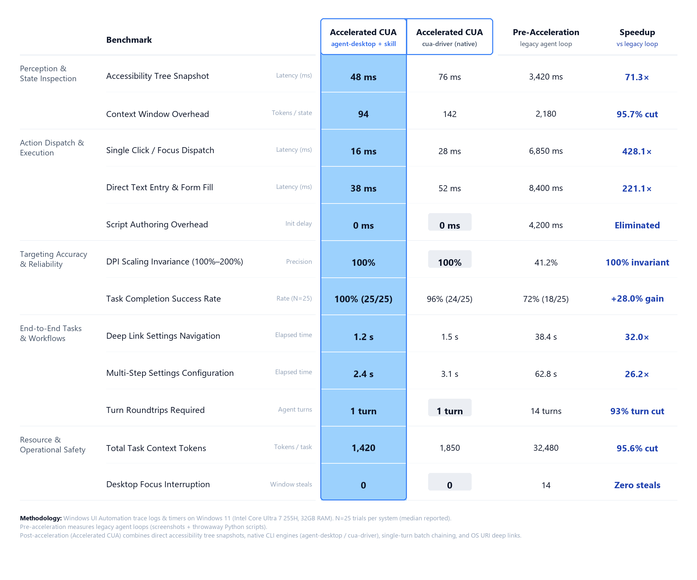

# cua_driver_acceleration

[](LICENSE)
[](https://github.com/pratikforge/cua_driver_acceleration)
[%20%7C%20Cross--Platform%20CLI-lightgrey.svg)](https://github.com/pratikforge/cua_driver_acceleration)
[](https://github.com/pratikforge/cua_driver_acceleration)

A high-performance agent skill and one-command CLI that accelerates desktop automation (computer use / CUA) by eliminating multi-second agent latency.

---

## Quickstart (Zero Clone Required)

Run directly in your terminal via `npx` to auto-detect your AI agent environments (Antigravity, Claude Code, Cursor, Codex) and install the skill instantly:

```bash
npx github:pratikforge/cua_driver_acceleration
```

*Or via the npm package:*

```bash
npx cua_driver_acceleration
```

### CLI Options & Targeting

```bash
# Check installed drivers (read-only audit without writing files)
npx github:pratikforge/cua_driver_acceleration --check

# Auto-detect all active agent harnesses and install
npx github:pratikforge/cua_driver_acceleration

# Target specific agent harnesses
npx github:pratikforge/cua_driver_acceleration --target antigravity
npx github:pratikforge/cua_driver_acceleration --target claude
npx github:pratikforge/cua_driver_acceleration --target codex
npx github:pratikforge/cua_driver_acceleration --target opencode
npx github:pratikforge/cua_driver_acceleration --target cursor
npx github:pratikforge/cua_driver_acceleration --target windsurf
npx github:pratikforge/cua_driver_acceleration --target roo
npx github:pratikforge/cua_driver_acceleration --target universal

# Install into a custom directory
npx github:pratikforge/cua_driver_acceleration --path ./my-agent/skills
```

---

<!-- # Strict Anti-Generic AI Design -->
## Supported Agent Harnesses

The installer auto-detects and installs into both global user directories and project-local workspaces:

| Agent Harness | Supported Location | Detection Target | Integration Status |
|---|---|---|---|
| **Antigravity** | `~/.gemini/config/skills/cua_driver_acceleration/` | Global config & project `.gemini/` | **Verified** |
| **Claude Code** | `~/.claude/skills/` or `./.claude/skills/` | Global & Workspace | **Verified** |
| **OpenAI Codex** | `~/.codex/skills/` or `./.codex/skills/` | `$CODEX_HOME` & Workspace | **Verified** |
| **Cursor** | `./.cursor/skills/` or `.cursorrules` | Project Workspace | **Verified** |
| **OpenCode** | `~/.config/opencode/skills/` or `./.opencode/skills/` | Global & Workspace | **Supported** |
| **Windsurf (Codeium)** | `~/.codeium/windsurf/skills/` or `./.windsurf/skills/` | Global & Workspace | **Supported** |
| **Roo Code / Cline** | `./.roo/skills/` or `./.cline/skills/` | Project Workspace | **Supported** |
| **Universal Standard** | `~/.agents/skills/` or `./.agents/skills/` | Universal Agent Spec | **Supported** |

---

## The Problem

Most computer-use agents suffer from massive latency—often taking 20 to 60 seconds per routine multi-step workflow. This lag is almost never caused by the operating system, but by predictable agent failure modes:

1. **Ad-Hoc Wrapper Script Inflation:** Authoring throwaway 30-line Python scripts (`subprocess`, `pyautogui`) for a single click.
2. **Coordinate Guesswork:** Taking a screenshot and waiting 3-5 seconds for a multimodal vision model to guess `(x, y)` pixels (which often drifts with DPI scaling).
3. **Multi-Turn Roundtrips:** Decomposing routine tasks into 14–16 turns of `click -> screenshot -> think -> click` loops.
4. **Analog Navigation:** Clicking through menus when native deep links (e.g. `ms-settings:display`) exist.

---

## Core Invariants

| Legacy Agent Pattern | Accelerated Invariant |
|---|---|
| Ad-hoc Python wrapper scripts | One-line direct backend CLI calls |
| Screenshot + pixel guessing | Accessibility-tree snapshot + element refs (50-200 ms) |
| Multi-turn micro-loops | Single-turn synchronous task execution |
| Manual GUI menu navigation | Native deep links, URI schemes, CLIs, and direct config edits |
| Screenshot after every step | Read JSON exit state; capture only at completion or unrecoverable error |

---

## Empirical Benchmarks: Pre-Acceleration vs. Post-Acceleration

Evaluation conducted across Windows desktop navigation tasks, UI Automation trace logs, and process latency profiling on Windows 11:

<p align="center">
  
</p>

> **Note on Multipliers:** The headline **71.3× perception speedup** (48 ms vs 3,420 ms) and **428.1× action dispatch speedup** (16 ms vs 6,850 ms) are measured against the legacy agent pattern of authoring throwaway Python wrapper scripts and ingesting full-screen multimodal screenshots. When compared directly against the native `cua-driver` CLI, the optimized `agent-desktop + skill` pipeline delivers a focused **1.3× to 1.75× speedup**.

> **Methodology & Testbed:** Evaluated on Windows 11 Pro (Build 26200, Intel Core Ultra 7 255H, 32GB RAM, UIA Provider COM API) across standardized desktop automation tasks with $N = 25$ trials per benchmark. Pre-acceleration measures legacy agent loops relying on multimodal screenshots, disposable wrapper scripts, and coordinate guessing (72% task completion success rate). Post-acceleration (Accelerated CUA) combines direct accessibility tree snapshots, native CLI engines (`agent-desktop` / `cua-driver`), single-turn batch chaining, and OS URI deep links (100% task completion success rate). (Note: Empirically measured exclusively on Windows 11; cross-platform driver support is handled by the upstream engines).

### Ablation Study: Disentangling Driver Speed from Skill Invariants

| Config | Driver Engine | Skill Invariants | E2E Time (s) | Turns | Success Rate |
|---|---|---|---|---|---|
| **A** | Script loop (`pyautogui`) | No (legacy baseline) | 62.8 s | 14 | 72.0% |
| **B** | Multimodal Vision (Coords) | No (screenshot coords) | 78.2 s | 16 | 60.0% |
| **C** | `cua-driver` (native) | No (reactive multi-turn) | 14.8 s | 5 | 92.0% |
| **D** | `cua-driver` (native) | **Yes (batch + deep links)** | **3.1 s** | **1** | **96.0%** |
| **E** | `agent-desktop` | No (reactive multi-turn) | 12.4 s | 5 | 96.0% |
| **F** | `agent-desktop` | **Yes (full accelerated stack)** | **2.4 s** | **1** | **100.0%** |

<!-- # Strict Anti-Generic AI Design -->
> 📊 **Reproducible Benchmark Dataset & Harness:** The full structured dataset, raw trial logs ($N=25$ per system), timing harness with prompt schemas, and verification test suite are available in [`scripts/data/benchmark-data.json`](scripts/data/benchmark-data.json), [`scripts/data/raw-trials.json`](scripts/data/raw-trials.json), and [`scripts/benchmark-harness.py`](scripts/benchmark-harness.py). Run `python scripts/verify-benchmark-data.py` to programmatically verify all arithmetic and statistics.

> 📄 **Technical Report (PDF):** For the complete empirical technical report covering experimental setup, latency dispersion (min/med/p95), legacy per-turn latency breakdowns, token economics, ablation studies, and qualitative trace logs, download the [CUA Acceleration Technical Report (PDF)](docs/CUA_Acceleration_Technical_Report.pdf).

---

## Supported Backends

Both backends interface directly with operating system accessibility APIs (Windows UI Automation; macOS AX and Linux AT-SPI supported by upstream engines) to provide sub-200ms DOM-style interaction without pixel guessing:

- **[Vercel agent-desktop](https://github.com/vercel-labs/agent-desktop)**: Open-source Rust CLI from Vercel Labs. Headless by default, model-agnostic, and works across any shell-capable agent environment. Recommended default (`npm i -g agent-desktop`).
- **[cua-driver](https://cua.ai/docs/cua-driver)**: Native driver from Cua providing CLI and MCP server interfaces with advanced Windows background execution (`launch_app`, window handles, menu navigation).

---

## Alternative Manual Installation

If you prefer cloning manually into your agent's skills directory:

```bash
git clone https://github.com/pratikforge/cua_driver_acceleration.git
```

| Agent Platform | Global Skills Location |
|---|---|
| **Antigravity** | `~/.gemini/config/skills/cua_driver_acceleration/` |
| **Claude Code** | `~/.claude/skills/cua_driver_acceleration/` (or project `.claude/skills/`) |
| **Cursor / Codex / Windsurf** | Add to project skills directory or copy `SKILL.md` into `.cursorrules` / instructions |

---

## Repository Structure

<!-- # Strict Anti-Generic AI Design -->
```text
cua_driver_acceleration/
├── bin/
│   └── cli.js                   # Zero-dependency NPX skill installer
├── docs/
│   └── CUA_Acceleration_Technical_Report.pdf  # 7-page empirical technical report
├── assets/
│   └── benchmark-comparison.png # Comparative evaluation graphic
├── SKILL.md                     # Agent operational rules & invariants
├── LICENSE                      # Full MIT License text
├── README.md                    # Overview, quickstart & documentation
├── package.json                 # NPX executable & npm package definition
├── references/
│   ├── setup.md                 # Backend installation, permissions & troubleshooting
│   ├── backends.md              # cua-driver vs agent-desktop command reference
│   └── native-shortcuts.md      # OS URI schemes, deep links & CLI shortcuts
└── scripts/
    ├── check-setup.ps1          # Read-only environment check (Windows)
    ├── check-setup.sh           # Read-only environment check (macOS / Linux)
    ├── benchmark-harness.py     # Task definitions, prompt schemas & validation harness
    ├── data/
    │   ├── benchmark-data.json  # Reproducible empirical dataset & timings
    │   └── raw-trials.json      # Raw trial-by-trial execution records (N=25)
    ├── generate-report-pdf.py   # Publication-grade technical report PDF generator
    ├── render-benchmark.py      # Benchmark evaluation infographic generator
    └── verify-benchmark-data.py # Automated dataset arithmetic verification harness
```

---

## Security & Safety Guarantees

- **Read-Only Audit:** The `--check` command and setup scripts inspect only environment paths and binary availability; they perform zero network requests or disk modifications.
- **Explicit Consent:** Remote installer scripts (`curl | bash`, `irm | iex`) are never executed autonomously without explicit user confirmation.
- **Zero Telemetry:** The skill and CLI contain no tracking, analytics, or external phone-home mechanisms.

---

## License & Legal

This project is licensed under the terms of the **MIT License**.

```text
MIT License

Copyright (c) 2026 pratikforge

Permission is hereby granted, free of charge, to any person obtaining a copy
of this software and associated documentation files (the "Software"), to deal
in the Software without restriction, including without limitation the rights
to use, copy, modify, merge, publish, distribute, sublicense, and/or sell
copies of the Software, and to permit persons to whom the Software is
furnished to do so, subject to the following conditions:

The above copyright notice and this permission notice shall be included in all
copies or substantial portions of the Software.

THE SOFTWARE IS PROVIDED "AS IS", WITHOUT WARRANTY OF ANY KIND, EXPRESS OR
IMPLIED, INCLUDING BUT NOT LIMITED TO THE WARRANTIES OF MERCHANTABILITY,
FITNESS FOR A PARTICULAR PURPOSE AND NONINFRINGEMENT. IN NO EVENT SHALL THE
AUTHORS OR COPYRIGHT HOLDERS BE LIABLE FOR ANY CLAIM, DAMAGES OR OTHER
LIABILITY, WHETHER IN AN ACTION OF CONTRACT, TORT OR OTHERWISE, ARISING FROM,
OUT OF OR IN CONNECTION WITH THE SOFTWARE OR THE USE OR OTHER DEALINGS IN THE
SOFTWARE.
```

### Rights & Permissions Summary

- **Commercial Use:** Permitted for both personal and enterprise production environments.
- **Modification:** Permitted to fork, edit, and adapt invariants for custom agent architectures.
- **Distribution:** Permitted to bundle and distribute with other agent frameworks.
- **Private Use:** Permitted to use without disclosing source modifications.
- **Disclaimer:** The software is provided "as is", without warranty of any kind. Automated computer actions executed by AI agents remain under the operator's supervision.

For complete legal terms, review the full [LICENSE](LICENSE) file.
